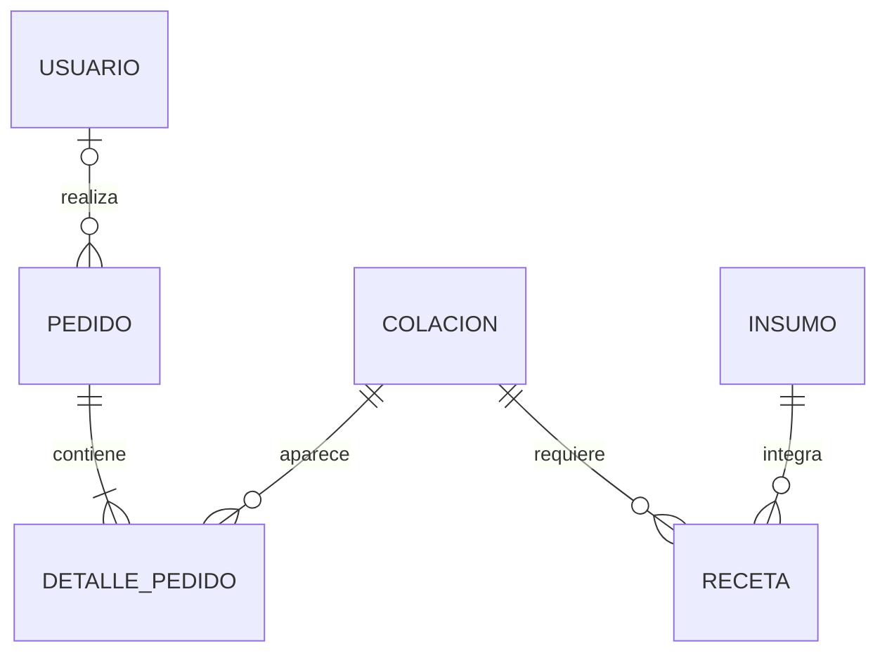

# Implementación de Django y SQLite en Colaciones

## 1. Qué cambió

Se conserva React, el diseño, los tres módulos y los perfiles. Django pasa a ser la autoridad de los datos y de las reglas de acceso. SQLite conserva los registros en `backend/db.sqlite3`, fuera del almacenamiento del navegador.

```text
Navegador / React (127.0.0.1:3002)
              │ /api/ (JSON, cookie de sesión, token CSRF)
              ▼
Vite: proxy hacia Django (127.0.0.1:8001)
              │ ORM de Django + transacciones
              ▼
backend/db.sqlite3
```

Los dos servidores se ejecutan con `iniciar.cmd`. Vite mantiene la actualización automática del frontend. Django se inicia sin autorecarga desde el comando conjunto para detener sus procesos correctamente; tras editar Python debe reiniciarse el comando.

No hay migración del localStorage. La primera base se inicializa con el catálogo estático original y una cuenta administradora nueva. No se crean clientes ni pedidos de prueba en la base real. `migrate` crea o actualiza la estructura; `init_local` solo crea el administrador o catálogo si faltan, sin sobrescribir stock, cuentas ni pedidos existentes. Los tests usan su propia base temporal.

## 2. Tablas del modelo relacional

Las seis entidades del diagrama están implementadas en `backend/core/models.py`. Los nombres físicos son minúsculos. Las claves primarias son enteros autoincrementales de Django (`BigAutoField`). Los importes de venta son pesos chilenos enteros.

### colacion

| Campo | Tipo / regla | Uso |
|---|---|---|
| id_colacion | Entero, PK | Identificador del plato |
| nombre_colacion | Texto de hasta 50, obligatorio | Nombre visible |
| descripcion_colacion | Texto de hasta 100, opcional | Descripción según el diagrama |
| precio_colacion | Entero no negativo | Precio en CLP |
| activa_colacion | Booleano | Oferta habilitada o pausada |
| categoria | Texto de hasta 50 | Filtros de la carta; ampliación |
| imagen | URL de hasta 500, opcional | Imagen actual de las tarjetas; ampliación |
| tiempo_estimado | Texto de hasta 30, opcional | Tiempo mostrado en la carta; ampliación |

Las porciones disponibles no se almacenan: se calculan a partir de las recetas y el stock. Sin receta configurada, el plato se considera no disponible. El motivo de falta de insumos solo se devuelve al administrador.

### insumo

| Campo | Tipo / regla | Uso |
|---|---|---|
| id_insumo | Entero, PK | Identificador |
| nombre_insumo | Texto de hasta 50, obligatorio | Nombre del ingrediente |
| unidad_medida_insumo | Texto de hasta 10 | kg, gr, un, lts o ml |
| stock_actual_insumo | Decimal (14,3), no negativo | Existencias |
| stock_minimo_insumo | Decimal (14,3), no negativo | Umbral de alerta |
| costo_unitario | Decimal (14,2), no negativo | Costo por unidad de medida; ampliación para el módulo financiero |

Se eligió `DecimalField` en lugar de los float del diagrama para trabajar con precisión definida en cantidades y costos. SQLite utiliza afinidad NUMERIC, no una implementación de decimales idéntica a PostgreSQL. Las operaciones de negocio usan `Decimal` en Python y se limitan a tres decimales para cantidades.

### receta

Cada fila es un ingrediente utilizado por una colación. Un plato puede tener muchas filas de receta; un insumo puede aparecer en varias colaciones.

| Campo | Tipo / regla |
|---|---|
| id_receta | Entero, PK |
| colacion_id | FK obligatoria → colacion.id_colacion |
| insumo_id | FK obligatoria → insumo.id_insumo |
| nombre_receta | Texto de hasta 50, obligatorio |
| cantidad_necesaria_receta | Decimal (14,3), estrictamente positivo |

No puede repetirse el mismo par colación–insumo. La cantidad se expresa en la unidad del insumo. Eliminar una colación elimina sus recetas; no puede eliminarse un insumo que esté siendo utilizado por recetas (`PROTECT`).

### usuario

Se usa un modelo de usuario propio de Django (`AbstractBaseUser` + `PermissionsMixin`), no una tabla separada del sistema de autenticación.

| Campo | Tipo / regla | Uso |
|---|---|---|
| id_usuario | Entero, PK | Identidad estable aunque cambie el nombre |
| username_usuario | Texto de hasta 30, único | Nombre para iniciar sesión |
| contraseña | Texto de hasta 128 en la base | Hash de Django; atributo Python `password` |
| rol | Texto de hasta 20 | cliente o administrador |
| direccion | Texto de hasta 120, opcional en la tabla | Campo del modelo actualizado; obligatorio en el formulario de cliente |
| telefono | Texto de hasta 15 | Ampliación necesaria para el perfil y autocompletado |
| username_clave | Texto de hasta 60, único | Clave técnica NFKC + casefold para unicidad con tildes y mayúsculas en SQLite |
| is_active, is_staff, is_superuser | Booleanos | Campos de autenticación y permisos de Django |
| last_login, date_joined | Fecha/hora | Seguimiento de acceso y creación |

La contraseña **no se almacena en texto plano** ni se limita la columna a 20 caracteres: un hash necesita más longitud. Las nuevas contraseñas requieren al menos ocho caracteres. Editar las credenciales del administrador exige la contraseña actual; cambiar la contraseña de un cliente también. Django mantiene la sesión al actualizar la propia contraseña y los siguientes ingresos usan las credenciales nuevas.

El invitado no es una cuenta en esta tabla: es una visita anónima. El registro público siempre crea un cliente y no acepta que el navegador se asigne el rol de administrador.

El cliente debe registrar nombre y dos apellidos como nombre de usuario, respetando los 30 caracteres del diagrama. Se admiten tildes y nombres compuestos. Esta regla comprueba al menos tres componentes de nombre; no puede deducir lingüísticamente dónde termina un nombre compuesto o un apellido compuesto.

### pedido

| Campo | Tipo / regla | Uso |
|---|---|---|
| id_pedido | Entero, PK | Número interno |
| fecha_hora_pedido | Fecha y hora, obligatoria | Momento de registro del servidor |
| nombre_cliente_pedido | Texto de hasta 40 | Nombre y dos apellidos del destinatario |
| telefono_cliente_pedido | Texto de hasta 15 | Teléfono de contacto |
| estado_pedido | Texto de hasta 20 | En curso, Listo, Entregado |
| metodo_pago_pedido | Texto de hasta 20 | Efectivo, Transferencia, Débito |
| total_pedido | Entero no negativo | Total calculado en el servidor |
| observaciones_pedido | Texto de hasta 200, opcional | Instrucciones para cocina |
| cliente_id | FK opcional → usuario.id_usuario | Historial privado del cliente; ampliación |
| tipo_entrega | Texto de hasta 30 | Retiro o despacho; ampliación |
| direccion_entrega | Texto de hasta 120, opcional | Obligatorio si hay despacho; ampliación |
| monto_paga_con | Entero opcional | Cálculo del vuelto; ampliación |
| solicitud_id | UUID único | Evita duplicar la confirmación de una compra |
| solicitud_sesion | Texto técnico de hasta 64 | Vincula la confirmación a la sesión que la originó |
| solicitud_hash | Texto técnico de 64 | Impide reutilizar una confirmación cambiando sus datos |

El diagrama especifica `number` para teléfono: se usa texto para conservar ceros iniciales y tratarlo como identificador de contacto. Se valida que contenga entre 8 y 15 dígitos, sin +, espacios ni símbolos. El número visible `#PED-<id_pedido>` se deriva de la PK, no se guarda dos veces.

La fecha se almacena con el manejo de zonas horarias de Django. La presentación usa la hora de Chile (`America/Santiago`, zona correspondiente también a Talca).

Nombre, teléfono y dirección son una instantánea del pedido: editar el perfil no altera comandas anteriores. Si el cliente elimina su cuenta, la FK pasa a NULL (`SET_NULL`); la comanda se conserva y no se cancela. Crear otra cuenta con el mismo nombre o teléfono no concede acceso al historial anterior.

### detalle_pedido

| Campo | Tipo / regla | Uso |
|---|---|---|
| id_detalle_pedido | Entero, PK | Identificador de línea |
| id_pedido | FK obligatoria → pedido.id_pedido | Pedido al que pertenece |
| id_colacion | FK obligatoria → colacion.id_colacion | Plato comprado |
| cantidad_detalle_pedido | Entero positivo | Cantidad |
| subtotal_detalle_pedido | Entero no negativo | Cantidad × precio confirmado |
| nombre_colacion | Texto de hasta 50 | Instantánea del nombre; ampliación |
| precio_unitario | Entero no negativo | Instantánea del precio; ampliación |
| costo_insumos | Decimal (16,3) | Costo de los ingredientes consumidos por esa línea; ampliación |

El par pedido–colación es único. Si se recibe el mismo plato varias veces en la solicitud, sus cantidades se agrupan. Eliminar un pedido elimina sus detalles (`CASCADE`); un plato referenciado por detalles no puede borrarse (`PROTECT`). Los campos de instantánea evitan que cambios posteriores en precio, nombre o costos reescriban la historia financiera.

## 3. Relaciones



La relación Usuario–Pedido es una ampliación respecto a la imagen: es indispensable para que el historial pertenezca a un cliente autenticado, sin depender de coincidencias de nombre o teléfono.

## 4. Tablas técnicas adicionales

Django crea `django_migrations`, `django_session`, `django_content_type`, `auth_permission`, `auth_group`, `auth_group_permissions`, las relaciones `usuario_groups` y `usuario_user_permissions`, y `django_admin_log`. No representan nuevas entidades comerciales; soportan migraciones, sesiones, permisos y el administrador de Django. No se crea la tabla estándar `auth_user`, porque el usuario propio la sustituye.

Las migraciones versionadas están en `backend/core/migrations/`. No se deben editar para cambiar una base en uso: modificar modelos y generar una migración nueva.

## 5. Flujo de una compra

1. React envía contacto, entrega, forma de pago, IDs de platos, cantidades y un UUID de confirmación. No decide el precio ni asigna el dueño del pedido.
2. Django valida los campos y toma el cliente desde la sesión autenticada. Invitados y pedidos ingresados por el administrador no se atribuyen a otro cliente por coincidencia de datos.
3. Dentro de una transacción SQLite `IMMEDIATE`, carga los platos, agrupa cantidades y suma los ingredientes compartidos por todos los platos.
4. Comprueba disponibilidad, calcula precios y costos, descuenta stock y crea pedido y detalles. Ante un error se revierte todo.
5. Una repetición de la misma confirmación, con los mismos datos y sesión, devuelve el pedido ya creado sin consumir stock otra vez. Una confirmación reutilizada con otros datos se rechaza.
6. Solo después de recibir éxito de Django se abre WhatsApp con la fecha, número, detalle y total confirmados. Si el navegador bloquea la ventana, la confirmación muestra un enlace para abrir el mensaje manualmente.

WhatsApp sigue siendo un canal de contacto; enviar el mensaje no es necesario para registrar la comanda y las solicitudes de cancelación no cancelan automáticamente pedidos. El sistema registra una forma de pago, no cobra dinero ni verifica una transferencia real.

El cuadre de caja filtra los pedidos del día actual según la fecha de Chile y utiliza los costos de insumos guardados al comprar. No recalcula ventas históricas usando costos actuales.

La cocina consulta los datos cada cinco segundos mientras la pestaña está visible. No se ha implementado WebSocket. El botón Entregado y la API exigen pasar previamente por Listo.

## 6. API y autorización

| Método y ruta | Función / acceso |
|---|---|
| GET /api/health/ | Estado técnico |
| GET /api/auth/session/ | Recuperar sesión y token CSRF |
| POST /api/auth/register/ | Registrar cliente |
| POST /api/auth/login/ | Iniciar sesión con Django |
| POST /api/auth/logout/ | Cerrar sesión |
| POST /api/auth/profile/ | Editar el propio perfil; credenciales del administrador según rol |
| POST /api/auth/delete/ | Eliminar la propia cuenta de cliente con contraseña |
| GET /api/state/ | Carta pública; historial propio para clientes; datos completos para administrador |
| POST /api/orders/ | Registrar un pedido (incluye invitados) |
| POST /api/orders/:id/status/ | Cambiar estado; administrador |
| POST /api/supplies/:id/stock/ | Ajustar o fijar stock; administrador |
| POST /api/dishes/:id/toggle/ | Activar o pausar plato; administrador |

Las sesiones residen en SQLite. El navegador recibe una cookie HttpOnly y envía un token CSRF en las peticiones que modifican datos. La API no devuelve hashes, contraseñas ni información de insumos a clientes o invitados. Manipular el frontend no permite obtener el rol de administrador ni acceder al historial de otro cliente.

El panel Django `/admin/` es una herramienta adicional de mantenimiento para usuarios con permisos; no reemplaza las pantallas React. El administrador inicial tiene acceso y desde allí se pueden mantener platos, recetas e insumos que todavía no tienen formularios completos en React.

## 7. Archivos y responsabilidades

| Archivo / carpeta | Responsabilidad |
|---|---|
| backend/config/ | SQLite, sesiones, CSRF, zona horaria y rutas |
| backend/core/models.py | Seis entidades, claves, relaciones y restricciones |
| backend/core/forms.py | Validaciones de contacto y longitudes |
| backend/core/views.py | API, permisos, transacciones y serialización |
| backend/core/admin.py | Mantenimiento desde Django Admin |
| backend/core/tests.py | Pruebas automatizadas |
| backend/catalogo_inicial.json | Catálogo estático inicial, sin clientes ni pedidos |
| backend/core/management/commands/init_local.py | Inicialización que no sobrescribe datos existentes |
| backend/bootstrap.py | Entorno Python, dependencias e inicialización |
| src/api.ts | Comunicación JSON y token CSRF |
| src/context/AuthContext.tsx | Sesión real y operaciones de cuentas |
| src/context/AppContext.tsx | Consulta y actualización de los datos del servidor |
| vite.config.ts | Proxy local /api/ → Django |
| scripts/start.mjs, iniciar.cmd | Inicio conjunto y cierre de procesos |

## 8. Pruebas y comprobaciones

La batería cubre CSRF, contraseñas almacenadas mediante hash, nombres y teléfonos, duplicados con tildes y mayúsculas, permisos de administrador, aislamiento de historial, precios calculados en servidor, descuento de stock, ingredientes compartidos, rollback, idempotencia, cambio de credenciales, eliminación de clientes y conservación de sus pedidos. Se ejecuta con `backend\.venv\Scripts\python.exe backend\manage.py test core`.

También se comprueban TypeScript, compilación Vite, `manage.py check` y que no falten migraciones. Los tests automáticos y una revisión de pantallas no equivalen a una auditoría de seguridad de producción ni a una prueba de carga de alta concurrencia.

## 9. Persistencia, respaldos y límites

- Cerrar el navegador no borra SQLite. Borrar sus datos del sitio cierra el acceso de ese navegador, pero no elimina cuentas, pedidos ni stock de la base.
- Otros navegadores del mismo equipo consultan la misma base a través del servidor. Esta configuración local no expone el servicio a la red.
- Para respaldar de forma sencilla, detener `iniciar.cmd` y copiar `backend/db.sqlite3` a una ubicación de respaldo. Con el sistema en uso se debe utilizar una copia mediante la API de backup de SQLite, no asumir que una copia parcial del archivo es consistente.
- `backend/.secret-key` mantiene la clave de sesiones. Guardarla de forma privada; cambiarla puede invalidar sesiones. La base, clave, entorno Python y cachés están excluidos de Git.
- No borrar la base ni ejecutar `flush` como parte del inicio habitual. El comando de inicio no restablece datos.
- Django conserva registros de sesión con una duración configurada de siete días. Para limpiar sesiones vencidas: `backend\.venv\Scripts\python.exe backend\manage.py clearsessions`.
- SQLite serializa escrituras; la transacción IMMEDIATE y el timeout evitan lecturas concurrentes que luego intentan escalar el bloqueo. Si se supera la capacidad local, la API devuelve un error temporal en lugar de simular un pedido exitoso. Para mayor concurrencia se recomienda evaluar PostgreSQL.
- Son servidores de desarrollo con DEBUG local. Antes de publicar: servidor de aplicación de producción, HTTPS, secretos y credenciales apropiados, DEBUG desactivado, cookies seguras, hosts/orígenes autorizados, límites de intentos de login, control de acceso a los archivos y respaldos probados.

## 10. Referencias oficiales

- [Usuario personalizado de Django](https://docs.djangoproject.com/en/6.0/topics/auth/customizing/)
- [Protección CSRF con solicitudes AJAX](https://docs.djangoproject.com/en/6.0/howto/csrf/)
- [Transacciones de Django](https://docs.djangoproject.com/en/6.0/topics/db/transactions/)
- [Notas de SQLite](https://docs.djangoproject.com/en/6.0/ref/databases/#sqlite-notes)

## Cancelación de pedidos

Se incorporó el estado Cancelado mediante una migración nueva. El administrador puede cancelar desde Cocina, previa confirmación en un diálogo. El pedido y sus detalles se conservan, el cliente ve el estado en su historial, y no se permite reactivar un pedido cancelado. Se excluye del cuadre diario de ventas. La cancelación repone los insumos por defecto. El administrador puede desmarcar la opción si ya se usaron. Se guarda en pedido.insumos_descontados una instantánea por insumo con las cantidades descontadas y se marca insumos_repuestos al devolverlas; toda la operación es transaccional y no se duplica al reintentar. Para pedidos anteriores a esta mejora se reconstruye el consumo con las recetas vigentes, pues no existía una instantánea histórica; los pedidos que ya estaban cancelados no se modifican ni reponen retroactivamente. Esta acción no procesa devoluciones de dinero.

